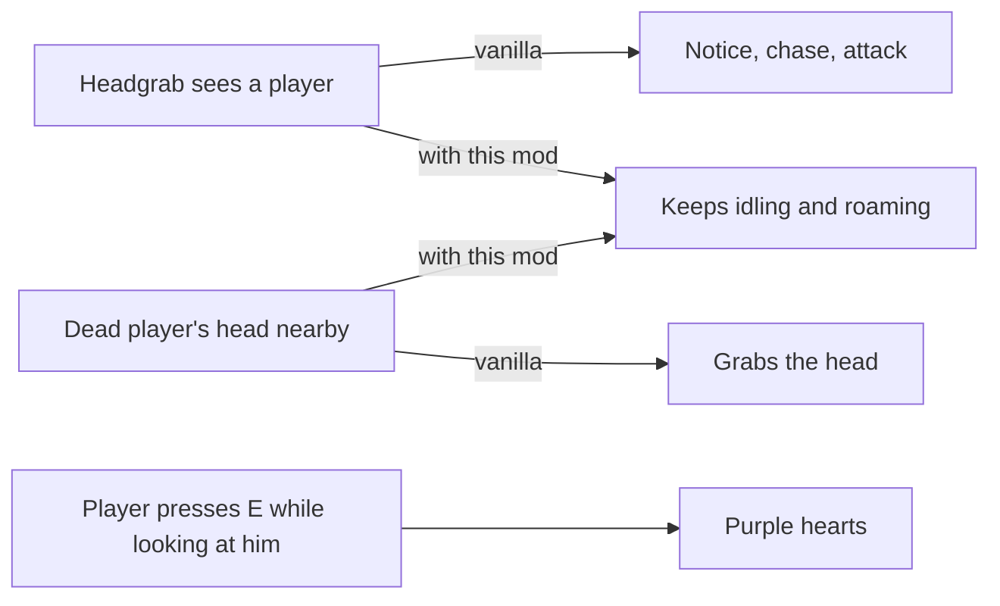

# Friendly Head Grabber

A mod for [R.E.P.O.](https://store.steampowered.com/app/3241660/REPO/) that makes the Headgrab enemy friendly. He wanders around, never attacks, and you can show him some love.

## What it does

- **He never attacks.** He does not notice, chase or dropkick players.
- **He leaves heads alone.** By default he no longer picks up the heads of dead players. A setting gives that back if you miss it.
- **You can pet him.** Look at him from close by and press E, and purple hearts float up above him.



## Settings

Change these in the in-game mod settings (with REPOConfig installed) or in `BepInEx/config/com.purplehaxttv.friendlyheadgrabber.cfg`.

| Section | Setting | Default | What it does |
| --- | --- | --- | --- |
| General | Leave player heads alone | true | Off lets him pick up dead players' heads again |
| Petting | Pet key | E | The key that pets him |
| Petting | Pet range | 4 | How close you have to be, in metres |

## Multiplayer

The host decides how he behaves, so the host needs the mod for him to be friendly. The hearts are shown only to the player who pressed the key, and only that player needs the mod to see them.

## Works with Friendly Duck

The hearts are the same ones [Friendly Duck](https://thunderstore.io/c/repo/p/purplehaxttv/FriendlyDuck/) uses. With both mods installed this one reuses Friendly Duck's copy; without it, it loads its own.

## Install

Install **FriendlyHeadGrabber** with a Thunderstore mod manager, or copy `FriendlyHeadGrabber.dll` and `friendlyheadgrabberassets` into the same folder under `BepInEx/plugins`.

## Build

The project builds against the game's own assemblies, so it needs R.E.P.O. and a BepInEx install on the machine.

```
dotnet build FriendlyHeadGrabber.csproj -c Release -p:GameDir="<path to REPO>" -p:BepInExDir="<path to BepInEx>"
```

`Dev/` holds a test harness that is not shipped. It starts a solo run, spawns a Headgrab next to the player and logs his state and the player's health.

## License

MIT